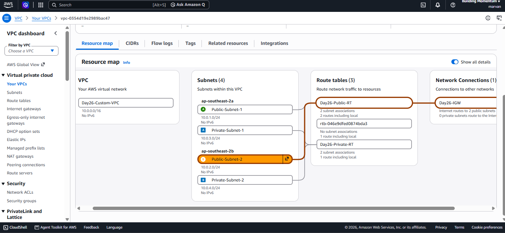

# 📅 Day 26 — Hands-On AWS VPC Build

## 🎯 Goal

Build a custom AWS network using a VPC, four subnets, an Internet Gateway, and route tables.

## 📚 What I Learned Today

- What a VPC is
- What a subnet is
- The difference between public and private subnets
- What an Internet Gateway (IGW) does
- What a route table does
- How to connect subnets to route tables
- How to view the network using the AWS VPC Resource Map

---

### 1. Create a Custom VPC

**VPC Name:** `Day26-Custom-VPC`

**IPv4 CIDR:** `10.0.0.0/16`

A VPC is a private virtual network in AWS. It gives us a network where we can create subnets and organize our cloud resources.

The CIDR `10.0.0.0/16` defines the IPv4 address range available for this VPC.

We created a custom VPC instead of changing the existing default VPC.

---

### 2. Create Four Subnets

A subnet is a smaller network inside a VPC. Each subnet has its own IP address range.

We created two public subnets and two private subnets.

| Subnet Name | IPv4 CIDR | Purpose |
|---|---|---|
| Public-Subnet-1 | `10.0.1.0/24` | Public network |
| Public-Subnet-2 | `10.0.2.0/24` | Public network |
| Private-Subnet-1 | `10.0.3.0/24` | Private network |
| Private-Subnet-2 | `10.0.4.0/24` | Private network |

All four subnet ranges are inside our VPC range, `10.0.0.0/16`, and do not overlap.

Each `/24` subnet contains 256 IPv4 addresses. AWS reserves 5 addresses in each subnet, leaving 251 usable IPv4 addresses.

#### Why Did I Create Public and Private Subnets?

Public subnets are designed for resources that may need a route to the internet.

Private subnets are designed for resources that should not have a direct default route to the Internet Gateway.

A subnet's name alone does not make it public or private. Its route table configuration determines its routing.

---

### 3. Create and Attach an Internet Gateway

**Internet Gateway Name:** `Day26-IGW`

An Internet Gateway (IGW) connects a VPC to the internet when the required routing and other network settings are configured.

We created an Internet Gateway and attached it to `Day26-Custom-VPC`.

#### Important

Creating an Internet Gateway does not automatically give every subnet internet access. The correct route table and other settings are also required.

---

### 4. Create the Public Route Table

**Route Table Name:** `Day26-Public-RT`

A route table contains rules that tell network traffic where to go.

We configured these routes:

| Destination | Target | Meaning |
|---|---|---|
| `10.0.0.0/16` | `local` | Route traffic within the VPC |
| `0.0.0.0/0` | `Day26-IGW` | Send unmatched IPv4 traffic toward the Internet Gateway |

#### What Does `0.0.0.0/0` Mean?

It is the default route for IPv4 traffic. When no more-specific route matches, traffic can use this route.

We associated `Day26-Public-RT` with:

- `Public-Subnet-1`
- `Public-Subnet-2`

Both public subnets now use this route table.

---

### 5. Create the Private Route Table

**Route Table Name:** `Day26-Private-RT`

We created a separate route table for our private subnets.

It contains this route:

| Destination | Target | Meaning |
|---|---|---|
| `10.0.0.0/16` | `local` | Route traffic within the VPC |

We did not add a default route to the Internet Gateway.

We associated this route table with:

- `Private-Subnet-1`
- `Private-Subnet-2`

This keeps the private subnets from having a direct default route to the Internet Gateway.

---

### 6. Final Network Architecture

```text
Day26-Custom-VPC
CIDR: 10.0.0.0/16
|
|-- Public-Subnet-1
|   CIDR: 10.0.1.0/24
|
|-- Public-Subnet-2
|   CIDR: 10.0.2.0/24
|
|-- Private-Subnet-1
|   CIDR: 10.0.3.0/24
|
|-- Private-Subnet-2
    CIDR: 10.0.4.0/24

Day26-Public-RT
|-- Associated with both public subnets
|-- 0.0.0.0/0 -> Day26-IGW
|-- 10.0.0.0/16 -> local

Day26-Private-RT
|-- Associated with both private subnets
|-- 10.0.0.0/16 -> local

Day26-IGW
|-- Attached to Day26-Custom-VPC
```

---

### 7. VPC Resource Map Screenshot

The screenshot shows the VPC, all four subnets, both route tables, and the Internet Gateway.

**Screenshot:** 


---

### 8. Important Notes

- The public route table has a default route to the Internet Gateway.
- The private route table does not have a direct default route to the Internet Gateway.
- A route to an Internet Gateway alone does not guarantee internet connectivity. Public IP assignment and appropriate security rules may also be required.
- I did not launch any EC2 instances.
- I did not create a NAT Gateway.
- I did not test actual internet connectivity.

#### ✅ Final Summary

Today, I built a custom AWS VPC with two public subnets, two private subnets, an Internet Gateway, and separate route tables.

I also associated the correct subnets with their route tables and verified the network using the AWS VPC Resource Map.

---
