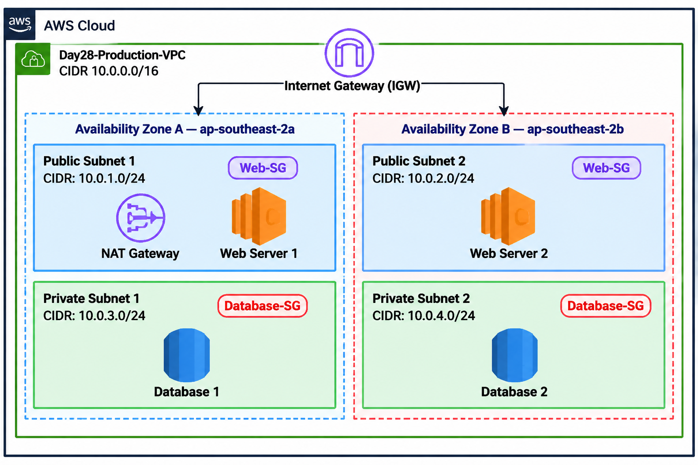

# 📅 Day 28 — AWS Network Architecture Project

## 🎯Goal 

Design a production-style AWS network architecture using Draw.io and document it in GitHub.

---

## 🏗️ Architecture Diagram

### 1. VPC

A **Virtual Private Cloud (VPC)** is a logically isolated network in AWS.

- **VPC Name:** `Day28-Production-VPC`
- **CIDR:** `10.0.0.0/16`
- **Region:** Asia Pacific (Sydney) — `ap-southeast-2`

### 2. Availability Zones and Subnets

The architecture uses two Availability Zones for separation and resilience.

| Availability Zone | Subnet | CIDR |
|---|---|---|
| `ap-southeast-2a` | Public Subnet 1 | `10.0.1.0/24` |
| `ap-southeast-2a` | Private Subnet 1 | `10.0.3.0/24` |
| `ap-southeast-2b` | Public Subnet 2 | `10.0.2.0/24` |
| `ap-southeast-2b` | Private Subnet 2 | `10.0.4.0/24` |

- **Public subnets:** Designed to host internet-facing web servers.
- **Private subnets:** Designed to host databases that should not be directly accessible from the internet.

### 3. Internet Gateway (IGW)

The Internet Gateway connects the VPC to the internet.

Public subnet route tables need an appropriate route to the IGW for internet-bound traffic. Internet access also depends on public IP addressing and security configuration.

### 4. NAT Gateway

The NAT Gateway is placed in Public Subnet 1 in this proposed design.

It allows resources in private subnets to initiate outbound internet connections without requiring their own public IP addresses.

Private route tables would use a route such as:

`0.0.0.0/0 → NAT Gateway`

**Cost warning:** NAT Gateways can incur hourly and data-processing charges. No NAT Gateway was created for this project.

### 5. Web Servers

The architecture includes two web servers:

- **Web Server 1:** Public Subnet 1
- **Web Server 2:** Public Subnet 2

The `Web-SG` label represents the intended web-server Security Group. It should allow only the required inbound traffic, such as HTTP/HTTPS, according to the application's needs.

### 6. Databases

The architecture includes two database components:

- **Database 1:** Private Subnet 1
- **Database 2:** Private Subnet 2

The `Database-SG` label represents the intended database Security Group. Database access should be restricted to authorized application resources, such as the web or application tier, on the required database port.

### 7. Security Groups

| Security Group | Purpose |
|---|---|
| `Web-SG` | Controls allowed traffic to the web servers |
| `Database-SG` | Restricts database access to authorized resources |

Security Group labels in this diagram represent the planned security design. The actual Security Groups have not been created for this project.

### 8. Traffic Flow

#### Public web traffic

Internet → Internet Gateway → Public Subnet → Web Server

#### Private database access

Web/Application Tier → Database Security Group Rules → Private Database

#### Private outbound internet access

Private Resource → Private Route Table → NAT Gateway → Internet Gateway → Internet

These flows describe the intended design. They have not been tested in a deployed environment.
